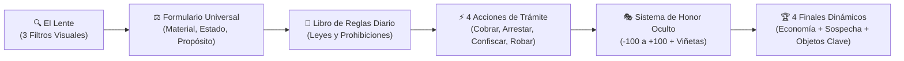

# 🎮 Dashboard - Notaría de Aventureros (GUILD Game Jam 2026)

> [!INFO] **Centro de Mando del Proyecto**
> Bóveda oficial del equipo para el desarrollo de **Notaría de Aventureros** (título alt.: *El Vacío Legal*) en la **GUILD Game Jam 2026**. 
> - **Proyecto:** *Notaría de Aventureros* / *El Vacío Legal* (Puzzle Lógico 2D / Simulador de Gestión Burocrática estilo *Papers, Please*)
> - **Premisa:** Eres un oficial de aduanas en un reino de fantasía opresivo. Evalúas el botín de los aventureros para cobrar impuestos, arrestarlos o confiscar sus bienes. Sin embargo, puedes usar tu posición para robar objetos y enriquecerte, operando al margen de la ley desde dentro del propio sistema.

---

## 🎯 Información de la Jam

- **Proyecto:** **Notaría de Aventureros** *(o El Vacío Legal)*
- **Evento:** **GUILD Game Jam 2026**
- **Organización:** GUILD (Comunidad / UMSA)
- **Modalidad:** **Híbrida**
  - 🎤 *Inauguración:* Presencial
  - 💻 *Desarrollo:* Virtual
  - 🏆 *Exhibición y Premiación:* **Presencial el 21 de noviembre de 2026**
- **Tema Oficial:** "Al otro lado de la Ley"
- **Reglamento Oficial:** [Canva: Reglamento para Participantes](https://www.canva.com/design/DAHWrFY2NkY/Z0Y2d94YiDCOIJ7EV6ScwA/view)
- **Plataforma:** Windows `.exe` / Motor Godot Engine 4.x (2D Pixel Art)
- **Host de la Jam:** *Itch.io*

---

## 👥 Equipo y Representación (2 a 5 Integrantes)

> *Nota reglamentaria: Cada integrante debe completar su formulario individual con el mismo nombre de equipo y designar a una persona como representante.*

- **Nombre del Equipo:** `[Por definir]`
- **Representante del Equipo:** `Michael`

| Integrante | Rol en el Equipo | Contacto / Discord | Formulario Enviado |
| :--- | :--- | :--- | :---: |
| **Michael** *(Rep)* | 🕹️ Dirección / Org. Ideas, 🎵 Música & 💻 Programación | `@michael` | [ ] |
| **Lucas** | 🎨 Sprites & Animaciones (Pixel Art), 💻 Programación | `@lucas` | [ ] |
| **Daniel** | 💻 Programación (Sistemas de UI, Lente, Drag & Drop) | `@daniel` | [ ] |
| **Esther** | 💻 Programación (Lógica Burocrática, Meta-juego, Honor) | `@esther` | [ ] |

---

## 🎲 Pilares del Nuevo Diseño

1. **El Escritorio de Inspección:** Herramientas físicas tangibles (El Lente con 3 espectros, Formulario Universal de coartadas con 3 menús desplegables, y Libro de Reglas diario).
2. **4 Resoluciones Progresivas:** `Cobrar` (D1), `Arrestar` (D1), `Confiscar` (D3) y `Robar` (D3, acción oculta/transgresora).
3. **Meta-Juego y Moralidad:** Sistema de Honor oculto (-100 a 100) con viñetas blanca/roja y feedback armónico/disonante; economía doméstica con soborno variable al Guardia Gato.
4. **Progresión y Meta:** Campaña de 5 días (8-10 objetos/día, 40-50 totales) con 4 finales narrativos según dinero, honor y objetos especiales (Libros de Alquimia y Carpintería).

---

## 🎨 Identidad Visual & Paleta (Inspirada en GUILD 2026)

- **Rojo Dragón (Principal):** `#D82B38` #D82B38
- **Cian / Turquesa Digital (Acento):** `#00F0FF` #00F0FF
- **Dorado / Escudo (Detalles):** `#E5A93C` #E5A93C
- **Azul Oscuro / Fondo Nocturno:** `#151B2E` #151B2E
- **Crema Pergamino (Contenedores):** `#FDF1D6` #FDF1D6

> Detalles y referencias completas en [[03_Arte_y_UI/Moodboard|Moodboard]].

---

## ⚖️ Criterios Oficiales de Evaluación del Jurado

1. 🎯 **Relación con la temática:** "Al otro lado de la ley" experimentado desde la corrupción y transgresión del propio funcionario de aduanas.
2. 🕹️ **Jugabilidad y experiencia:** Bucle deductivo tenso estilo *Papers, Please* con feedback audiovisual inmediato.
3. 💡 **Creatividad e innovación:** Lente multi-espectro, creación de coartadas legales y mecánica oculta de robo sin precio explícito.
4. ⚙️ **Calidad técnica y funcionamiento:** Arquitectura modular en Godot 4.x con shaders y evaluación por reglas booleanas.
5. 🎨 **Arte, sonido y presentación:** Pixel art lúgubre medieval, foley de oficina arcaica y música adaptativa con feedback de honor.

---

## 🗺️ Accesos Rápidos a la Bóveda

- 📜 **Reglamento y Entregas:** [[00_Inicio/Reglas y Entregables|Reglas y Entregables Oficiales]]
- 📋 **Gestión del Trabajo:** [[01_Planificacion_y_Tareas/Kanban|Tablero Kanban]] | [[01_Planificacion_y_Tareas/Cronograma|Cronograma & Fechas Clave]]
- 📖 **Diseño de Juego (GDD):**
  - [[02_Game_Design_Document_GDD/Mecánicas Core|Mecánicas Core & Resoluciones]]
  - [[02_Game_Design_Document_GDD/Historia y Personajes|Historia, Personajes y Familia]]
  - [[02_Game_Design_Document_GDD/Diseño de Niveles|Progresión (5 Días) y 4 Finales]]
- 🎨 **Arte & UI:** [[03_Arte_y_UI/Diseño de Interfaz|Diseño de Interfaz (Mesa de Trabajo)]] | [[03_Arte_y_UI/Lista de Assets Visuales|Lista de Assets Visuales]] | [[03_Arte_y_UI/Moodboard|Moodboard]]
- 🔊 **Audio:** [[04_Audio/Lista de SFX|Lista de SFX]] | [[04_Audio/Referencias Musicales|Referencias Musicales]]
- 💻 **Desarrollo:** [[05_Programacion/Convenciones|Arquitectura Godot & Convenciones]] | [[05_Programacion/Flujo de Git|Flujo de Git]] | [[05_Programacion/Bugs y Fixes|Bugs y Fixes]]
- 💡 **Espacio Libre:** [[06_Brainstorming_y_Notas/Ideas y Notas de Reunión|Brainstorming & Standups]]
