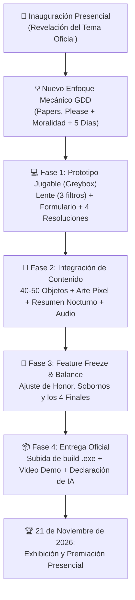

# ⏱️ Cronograma - GUILD Game Jam 2026

> [!INFO] **Modalidad Híbrida del Evento**
> - **Inauguración presencial:** Anuncio oficial de la temática ("Al otro lado de la ley").
> - **Fase de desarrollo:** Virtual con actividades de acompañamiento.
> - **Cierre de entrega oficial:** Congelación de build y subida final a plataforma host (Itch.io).
> - **Exhibición y Premiación:** **Presencial el 21 de noviembre de 2026** *(asistencia obligatoria de al menos un integrante)*.

---

## 🗺️ Flujo de Trabajo hacia la Entrega

---

## 📅 Hitos del Proyecto

### 🚩 Hito 1: Conceptualización & Pivote de Diseño (Kickoff)
- [x] Asistir a la inauguración y registrar el tema oficial: *"Al otro lado de la ley"*.
- [x] Definir el nuevo diseño formal: *Notaría de Aventureros* / *El Vacío Legal* (simulador de aduanas con corrupción interna y robo diegético).
- [ ] Verificar que todos los miembros enviaron su formulario individual con el mismo nombre de equipo.

### 🏃 Hito 2: Desarrollo & Prototipo Core (Mecánicas & Núcleo)
- [ ] Prototipar la mesa de trabajo (`Desk_View.tscn`).
- [ ] Implementar el control de **El Lente** con sus 3 filtros visuales (Espectro Mágico, Biológico y Rayos X).
- [ ] Construir el **Formulario Universal** con sus 3 listas desplegables (Material, Estado, Propósito).
- [ ] Programar las 4 acciones de resolución: `Cobrar`, `Arrestar`, `Confiscar` (D3+) y `Robar` (D3+).
- [ ] Conectar el **Sistema de Honor** (-100 a +100) con feedback inmediato (viñetas blanca/roja y acordes consonantes/disonantes).

### 🎨 Hito 3: Integración de Contenido, Economía & Audio
- [ ] Configurar la base de datos de 40-50 objetos (incluyendo los ítems clave: **Libro de Alquimia** y **Libro de Carpintería**).
- [ ] Implementar la pantalla de **Resumen Diario**: sueldo, comisiones, venta de robos, gastos de subsistencia y el soborno escalonado al **Guardia Gato**.
- [ ] Programar la lógica de los 5 días de progresión y la evaluación de los **4 Finales** al concluir el Día 5.
- [ ] Sustituir placeholders por sprites finales de pixel art y foley de audio / BGM dinámico con filtro Low-Pass.

### 🛑 Hito 4: Congelación (Feature Freeze) & Empaquetado
- [ ] **Congelar código:** Cero mecánicas nuevas 6-8 horas antes del cierre.
- [ ] Balancear la economía doméstica para evitar game overs injustos en Día 1 y asegurar que los 4 finales sean alcanzables.
- [ ] Resolver bugs críticos registrados en [[05_Programacion/Bugs y Fixes|Bugs y Fixes]].
- [ ] Exportar ejecutable para Windows `.exe` y verificar en una computadora limpia.
- [ ] Grabar video de gameplay de 30 a 60 segundos para la organización.
- [ ] Completar la declaración obligatoria de recursos y uso de IA en [[00_Inicio/Reglas y Entregables|Reglas y Entregables]].
- [ ] Subir la build final a la plataforma host antes del límite de entrega.

### 🏆 Hito 5: Exhibición & Premiación (21 de Noviembre de 2026)
- [ ] Coordinar la presencia física de Michael y los integrantes del equipo en la sede presencial.
- [ ] Llevar respaldo del build jugable en memoria USB y laptop de muestra.
- [ ] Preparar el pitch de 1 minuto destacando la temática, la mecánica oculta de robo y los 4 finales narrativos.
