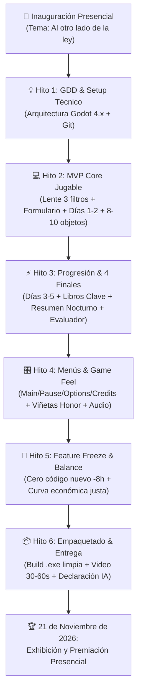

# ⏱️ Cronograma & Hitos - GUILD Game Jam 2026

> [!INFO] **Modalidad Híbrida del Evento**
> - **Inauguración presencial:** Anuncio oficial de la temática ("Al otro lado de la ley").
> - **Fase de desarrollo:** Virtual con actividades de acompañamiento.
> - **Cierre de entrega oficial:** Congelación de build y subida final a plataforma host (Itch.io).
> - **Exhibición y Premiación:** **Presencial el 21 de noviembre de 2026** *(asistencia obligatoria de al menos un integrante)*.

---

## 🗺️ Flujo de Trabajo hacia una Entrega Exitosa

---

## 📅 Desglose de Hitos y Criterios de Aceptación

### 🚩 Hito 1: Conceptualización, Setup & Arquitectura (Completado)
- [x] Asistir a la inauguración y registrar el tema oficial: *"Al otro lado de la ley"*.
- [x] Definir y aprobar el GDD formal: *Notaría de Aventureros* / *El Vacío Legal* (simulador de aduanas con corrupción interna y robo diegético).
- [x] Documentar la arquitectura modular en Godot 4.x y el árbol de escenas (`Convenciones.md`).
- [x] Establecer el flujo de Git por ramas para Daniel, Esther, Michael y Lucas (`Flujo de Git.md`).
- [ ] Verificar que los 4 miembros hayan enviado su formulario individual con el mismo nombre de equipo.

---

### 🏃 Hito 2: MVP Core Jugable (Días 1 y 2 - Vertical Slice)
> **Meta:** Tener un bucle jugable en pantalla lo antes posible para validar la diversión sin depender de decenas de assets.
- [ ] Programar `Tool_Lens.tscn` con drag & drop suave, límites de mesa y los 3 shaders de espectro (`spectrum_magic`, `spectrum_bio`, `spectrum_xray`).
- [ ] Construir el `Universal_Form.tscn` con sus 3 listas desplegables (`OptionButton`) y emisión de coartadas.
- [ ] Implementar `DailyRulesDatabase.gd` con normativas y prohibiciones de los Días 1 y 2.
- [ ] Configurar el Autoload `GameManager.gd` para gobernar el estado de la partida (Día, Dinero, Honor).
- [ ] Ensamblar la mesa interactiva `Desk_View.tscn` con acciones básicas activas: `Cobrar` y `Arrestar`.
- [ ] Integrar catálogo MVP de 8 a 10 objetos iniciales que enseñen las reglas de Días 1 y 2.

---

### ⚡ Hito 3: Progresión Completa, Economía & 4 Finales (Días 3 al 5)
> **Meta:** El juego debe poder jugarse de principio a fin, desbloqueando el arco moral completo.
- [ ] Habilitar acciones `Confiscar` y la acción oculta `Robar` a partir del Día 3 en `Action_Panel.tscn`.
- [ ] Expandir `DailyRulesDatabase.gd` con las leyes de Días 3 a 5 y casos de vacíos legales.
- [ ] Diseñar e integrar prioritariamente los dos objetos clave: ⭐ **Libro de Alquimia** (Día 3) y ⭐ **Libro de Carpintería** (Día 4).
- [ ] Ampliar catálogo a 18-22 objetos variados (garantizando cobertura balanceada para los 5 días).
- [ ] Implementar la pantalla de `Day_Summary.tscn`: balance diario, venta de robos, sustento familiar y cuota creciente de **Soborno al Guardia Gato**.
- [ ] Incorporar pistas narrativas familiares: interés de la hija por transmutación (D3) y compra masiva de madera por el hijo (D4).
- [ ] Programar evaluador de los **4 Finales** y pantalla de derrota por inanición (`Endings_Screen.tscn`).

---

### 🎛️ Hito 4: Menús del Sistema, Audio & Game Feel (Pulido de Jam)
> **Meta:** Garantizar una experiencia profesional para el jurado (cero sensación de prototipo tosco).
- [ ] Diseñar `MainMenu.tscn` (Jugar, Opciones, Créditos, Salir) con estética pixel art coherente.
- [ ] Implementar `OptionsMenu.tscn` reutilizable (volumen Master/BGM/SFX mediante `AudioServer` y toggle Fullscreen) integrable en Main Menu y Pause Menu.
- [ ] Programar `PauseMenu.tscn` accesible en todo momento con la tecla `Escape`.
- [ ] Construir `CreditsMenu.tscn` con créditos completos del equipo y mención obligatoria de GUILD Jam 2026.
- [ ] Configurar `SceneTransition.tscn` para fundidos a negro limpios entre cambios de escena.
- [ ] Implementar pantalla de inicio de jornada (`Day_Intro.tscn`) con el decreto matutino del Reino.
- [ ] Conectar `Honor_Vignette.tscn` (viñetas blanca/roja) con feedback sensorial inmediato.
- [ ] Foley completo de aduana, BGM *Gnossienne No. 1* con Low-Pass dinámico y modulación vocal de personajes (`vox`).
- [ ] Sprites de reacción del Guardia Gato (idle con armadura, sospecha y guiño/cómplice al robar).
- [ ] Ilustrar las 4 pantallas de epílogo para los 4 finales y Game Over.

---

### 🛑 Hito 5: Feature Freeze Estricto, Balance & QA
> **Meta:** Cero sorpresas de última hora. Cerrar el código con tiempo para pulir.
- [ ] **Congelación estricta de código (8 horas antes del cierre):** Cero mecánicas ni features nuevas.
- [ ] Balancear la economía doméstica diaria para evitar bancarrotas injustas en Días 1 y 2.
- [ ] Comprobar exhaustivamente que la matriz de los 4 Finales se active de forma fiable según Dinero, Honor y Libros.
- [ ] Resolver exclusivamente bugs bloqueantes registrados en [[05_Programacion/Bugs y Fixes|Bugs y Fixes]].
- [ ] Probar el bucle completo de juego repetidas veces sin saltarse días ni menús.

---

### 📦 Hito 6: Empaquetado Oficial & Requisitos de Entrega
> **Meta:** Cumplir al 100% el reglamento de la organización y evitar descalificaciones.
- [ ] Completar obligatoriamente la **tabla de declaración de recursos de terceros y uso de IA generativa** en [[00_Inicio/Reglas y Entregables|Reglas y Entregables]].
- [ ] Exportar ejecutable para Windows `.exe` y verificar ejecución en una PC limpia (sin Godot instalado).
- [ ] Grabar y editar video corto de gameplay (30 a 60 segundos) para la exhibición.
- [ ] Redactar y configurar la página de entrega en **Itch.io** (título, sinopsis, controles, créditos e instrucciones de instalación).
- [ ] Subir la build final a Itch.io al menos 2 horas antes de la hora límite oficial.

---

### 🏆 Hito 7: Exhibición & Premiación Presencial (21 de Noviembre de 2026)
- [ ] Coordinar la presencia física de Michael y los miembros del equipo en la sede presencial.
- [ ] Llevar respaldo en memoria USB (build `.exe` testeada, video demo y laptop de muestra con cargador).
- [ ] Preparar un pitch conciso de 1 minuto destacando la temática, la mecánica oculta de robo, la moralidad diegética y los 4 finales narrativos.
