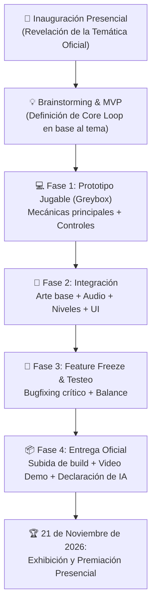

# ⏱️ Cronograma - GUILD Game Jam 2026

> [!INFO] **Modalidad Híbrida del Evento**
> - **Inauguración presencial:** Anuncio oficial de la temática.
> - **Fase de desarrollo:** Virtual con actividades de acompañamiento.
> - **Cierre de entrega oficial:** Congelación y subida final a plataforma host.
> - **Exhibición y Premiación:** **Presencial el 21 de noviembre de 2026** *(asistencia obligatoria de al menos un integrante)*.

---

## 🗺️ Flujo de Trabajo hacia la Entrega

---

## 📅 Hitos del Proyecto

### 🚩 Hito 1: Apertura & Conceptualización (Día de Inauguración)
- [ ] Asistir a la inauguración presencial y registrar la temática oficial.
- [ ] Brainstorming del equipo enfocado en el criterio de *Relación con la temática* e *Innovación*.
- [ ] Definir el alcance mínimo (MVP) para no caer en *feature creep*.
- [ ] Verificar que todos los miembros completaron su formulario individual con el mismo nombre de equipo.

### 🏃 Hito 2: Desarrollo & Prototipo (Mecánicas & Núcleo)
- [ ] Montar controlador del jugador, cámara y colisiones.
- [ ] Testear el Core Loop: ¿Es divertido jugar solo con cubos/sprites temporales?
- [ ] Primer pase de arte (estilo visual acorde al tema) y música base.
- [ ] Asistir a actividades virtuales de acompañamiento organizadas por GUILD.

### 🎨 Hito 3: Integración de Contenido & Audio
- [ ] Diseñar y montar los niveles del juego.
- [ ] Sustituir placeholders por assets finales de arte y sonido.
- [ ] Diseñar menú principal, pantalla de controles, pausa y game over.
- [ ] Comenzar a documentar recursos externos y posibles herramientas de IA en [[00_Inicio/Reglas y Entregables|Reglas y Entregables]] para la declaración obligatoria.

### 🛑 Hito 4: Congelación (Feature Freeze) & Empaquetado
- [ ] **Congelar código:** Cero mecánicas nuevas 6-8 horas antes del límite.
- [ ] Resolver bugs críticos registrados en [[05_Programacion/Bugs y Fixes|Bugs y Fixes]].
- [ ] Exportar builds (Web/Desktop) y probar en máquinas ajenas.
- [ ] Grabar video corto de demostración (gameplay de 30 a 60 segundos).
- [ ] Redactar la descripción, lista de controles, créditos e instrucciones de instalación.
- [ ] Subir el proyecto a la plataforma oficial antes del cierre.

### 🏆 Hito 5: Exhibición & Premiación (21 de Noviembre de 2026)
- [ ] Coordinar la presencia física del equipo (o de al menos un representante en caso de residir en otro departamento).
- [ ] Llevar copias de seguridad de la build jugable en USB o portátil para la muestra.
- [ ] Preparar pitch corto de 1 minuto para presentar el juego al público y al jurado evaluador.
