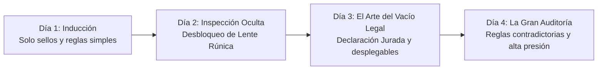

# 🗺️ Estructura de Días y Progresión - Notaría de Aventureros

> [!NOTE] **Formato de Jornadas Laborales**
> En lugar de niveles espaciales de scroll, la progresión se organiza por **Días Laborales** (Turnos de 3 a 5 aventureros por día) con reglas acumulativas y crecientes.

---

## 📈 Curva de Dificultad (4 Días de Jornada)

---

## 📅 Desglose de Jornadas

### 🌅 Día 1: "Bienvenido a la Aduana"
- **Objetivo pedagógico:** Aprender el arrastre de sellos y la lectura básica del Libro de Reglas.
- **Herramientas disponibles:** Sellos de madera (`Aprobado`, `Denegado`), Libro de Reglas básico.
- **Clientes (3 casos):**
  1. *Aventurero con escudo común:* Pasa sin problemas.
  2. *Guerrero con hacha gigante que excede el peso permitido:* Requiere sello de rechazo.
  3. *Mago novato con pergamino exento de tasas:* Aprobación directa.
- **Riesgo:** Multas mínimas para permitir aclimatarse al UI.

---

### 🔍 Día 2: "Lo que el Ojo no ve"
- **Objetivo pedagógico:** Introducir la herramienta de inspección interactiva.
- **Nueva herramienta:** **Lente Rúnica**.
- **Mecánica:** Al arrastrar la lente sobre los objetos del cuenco, se revelan auras invisibles (fuego, veneno, maldición).
- **Clientes (4 casos):**
  - Espada aparentemente normal que bajo la lente revela una runa flamígera prohibida.
  - Frasco de "medicina" que bajo la lente resulta ser veneno de basilisco.
  - Amuleto que reacciona a magia sagrada permitida.

---

### 📜 Día 3: "La Declaración Jurada"
- **Objetivo pedagógico:** Forzar la reinterpretación lógica para evadir impuestos.
- **Nueva mecánica:** Formulario interactivo con menús desplegables (`OptionButton`).
- **Reto:** El aventurero no puede pagar el 80% de arancel de su botín. Debes seleccionar en el formulario una justificación técnica válida según las excepciones del manual (ej. clasificar un *Cráneo Maldito* como *"Material de investigación pedagógica"*).
- **Clientes (4 casos):** Casos donde el soborno es alto si logras el vacío legal, pero la multa es severa si te equivocas.

---

### ⚖️ Día 4: "La Gran Auditoría" (Clímax de la Jam)
- **Objetivo pedagógico:** Poner a prueba la agilidad mental con normativas contradictorias dictadas por el Rey en su último decreto matutino.
- **Condiciones especiales:**
  - El Inspector Real realiza chequeos sorpresa.
  - Clientes con 2 o más objetos simultáneos que interactúan entre sí.
- **Final:** Si superas la jornada con fondos suficientes para el alquiler y sobras, desbloqueas el final de "Maestra Notaria de la Resistencia".
