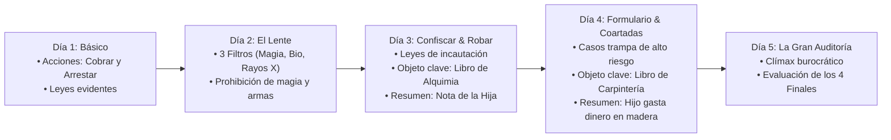

# 🗺️ Progresión de Jornadas (5 Días) y Finales - Notaría de Aventureros

> [!NOTE] **Estructura y Ritmo de la Campaña**
> La partida transcurre a lo largo de **5 Jornadas Laborales**. Cada jornada dura entre **2 y 3 minutos en tiempo real**, procesando de **8 a 10 objetos** por día (estimado total: **40 a 50 objetos** a lo largo de toda la partida).

---

## 📈 Curva de Dificultad y Progresión Mecánica

---

## 📅 Desglose de las 5 Jornadas

### 🌅 Día 1: "El Primer Turno en la Aduana"
- **Duración / Volumen:** ~2-3 minutos | 8-10 clientes y objetos.
- **Mecánicas Desbloqueadas:** 
  - Acciones activas: `💰 Cobrar` y `⛓️ Arrestar`.
- **Leyes del Libro de Reglas:**
  - Objetos comunes pagan arancel básico legal.
  - Contrabando bélico manifiesto (ej. hachas de guerra gigantes sin licencia) exige arresto inmediato.
- **Objetivo Pedagógico:**
  - Familiarizarse con el flujo de inspección en mesa, la lectura del Libro de Reglas y la diferencia entre cobrar (sueldo base) y arrestar (comisión por captura vs. pérdida de honor si arrestas a un inocente).
- **Fin del Día:**
  - Resumen contable sin sobresaltos. Gastos fijos de subsistencia básica.

---

### 🔍 Día 2: "Los Ojos de la Verdad (El Lente)"
- **Duración / Volumen:** ~2-3 minutos | 8-10 clientes y objetos.
- **Nueva Herramienta:** 
  - **El Lente** con sus 3 filtros intercambiables: **Espectro Mágico**, **Biológico** y **Rayos X**.
- **Leyes del Libro de Reglas:**
  - La Corona prohíbe severamente la posesión ciudadana de **armas ocultas** y **artefactos imbuidos de magia**. Todo portador debe ser **arrestado en el acto**.
- **Dinámica de Puzzle:**
  - Los objetos engañan a simple vista. Una empuñadura parece inofensiva hasta que la examinas bajo Rayos X y revelas una hoja retráctil envenenada; un relicario de plata resplandece con runas prohibidas bajo el Espectro Mágico.
- **Fin del Día:**
  - Se incrementan los gastos del hogar. El jugador siente la necesidad de conseguir ingresos adicionales mediante comisiones.

---

### 📦 Día 3: "La Línea de la Transgresión (Confiscar y Robar)"
- **Duración / Volumen:** ~2-3 minutos | 8-10 clientes y objetos.
- **Nuevas Acciones Habilitadas:**
  - `📦 Confiscar`: Quitar el objeto para las arcas del reino (bono de incautación legal).
  - `🤫 Robar`: **Mecánica oculta**. El Libro de Reglas no la menciona en absoluto. Te embolsas el botín bajo el escritorio. Baja tu honor e incrementa la sospecha del reino.
- **Leyes del Libro de Reglas:**
  - Se especifica qué materias y reliquias antiguas deben ser incautadas para los almacenes de la Corona.
- **⭐ Evento y Objeto Clave:**
  - Entre los aventureros aparece un anciano con el **Libro de Alquimia**.
  - Si el jugador lo confisca o cobra, se pierde para siempre; si lo **roba y decide conservarlo** (no venderlo en el resumen), se guarda en el baúl personal.
- **Fin del Día (Pantalla de Resumen):**
  - **Alerta de Soborno:** Si robaste objetos, la cuota de *"Soborno al Guardia Gato"* sube notablemente.
  - **Pista Narrativa Familiar:** Una nota avisa que **tu hija muestra un apasionado interés por la transmutación de elementos y la alquimia**.

---

### ⚖️ Día 4: "El Vacío Legal (Ingeniería Burocrática)"
- **Duración / Volumen:** ~2-3 minutos | 8-10 clientes y objetos.
- **Complejidad Máxima de Formulario:**
  - Obliga a usar con extrema precisión **El Lente** y el **Formulario Universal** (Material, Estado, Propósito).
  - Leyes contradictorias: Si dices la verdad sobre ciertos botines de clientes respetables, tendrías que arrestarlos injustamente; mentir creando un vacío legal te permite ayudarlos o justificar transacciones complejas.
- **⭐ Evento y Objeto Clave:**
  - Aparece un cliente con un tratado técnico: el **Libro de Carpintería**.
  - Si lo **robas y decides conservarlo**, activas la segunda mitad del misterio familiar.
- **Fin del Día (Pantalla de Resumen):**
  - **Gasto Imprevisto Fuerte:** El resumen avisa que **tu hijo necesita con urgencia un oficio digno**. El muchacho tomó dinero de la caja fuerte familiar y **compró un enorme cargamento de madera común**. Tu liquidez cae en picada; si no tenías suficientes ahorros, puedes rozar la bancarrota.

---

### 👑 Día 5: "La Gran Auditoría y la Resolución"
- **Duración / Volumen:** ~2-3 minutos | 8-10 clientes y objetos.
- **Condición de Presión:**
  - Clímax de dificultad. Clientes con objetos de múltiples espectros (mágico + biológico) y valores incalculables.
  - El jugador debe balancear con frialdad si necesita oro urgente o si debe limpiar su honor para evitar el desenlace fatal.
- **Resolución al Concluir la Jornada:**
  - No hay Día 6. El sistema computa los 3 valores maestros: **Dinero acumulado**, **Nivel de Honor** y **Posesión de Objetos Especiales** en el baúl.

---

## 🏆 Matriz de los 4 Finales (Condiciones de Victoria / Desenlace)

| Final | Título | Condiciones Requeridas | Narrativa y Epílogo |
| :---: | :--- | :--- | :--- |
| **1** | **🪦 El Buen Ciudadano Muerto** | - Poco o nada de dinero al final. - Honor Alto ($> +40$). | Fuiste un oficial intachable y ciego a la corrupción del reino. Jamás robaste ni aceptaste sobornos, pero tu sueldo miserable no alcanzó para cubrir la comida ni las medicinas. El protagonista y su familia mueren de inanición en la más absoluta soledad. |
| **2** | **⛓️ El Corrupto Descubierto** | - Mucho dinero acumulado ($> 500$ monedas). - Honor Muy Bajo ($-100$ a $-50$, alta sospecha). | Acumulaste una fortuna descarada saqueando a los aventureros. El Inspector Real y la guardia del rey asaltan tu casa a medianoche: tus bienes son incautados, tu familia te repudia por la deshonra y pasas el resto de tus días en las mazmorras subterráneas. |
| **3** | **🍷 El Burócrata Gris (La Burguesía)** | - Mucho dinero acumulado ($> 500$ monedas). - Honor Equilibrado / Neutro (rondando el cero negativo, $-25$ a $+20$). | Supiste cuándo obedecer y cuándo desviar la mirada. Robaste con cautela, mantuviste contento al Guardia Gato y tu expediente oficial permaneció impoluto. Te retiras de la aduana, tu familia vive con comodidades y ascienden como respetables miembros de la nueva burguesía mercantil. |
| **4** | **👑 El Imperio Familiar (Final Secreto)** | - Haber **Robado y Conservado** el **Libro de Alquimia** (Día 3). - Haber **Robado y Conservado** el **Libro de Carpintería** (Día 4). - Sobrevivir financieramente al gasto en madera del hijo. | Guiado por las pistas del diario familiar, conservaste ambos textos. Gracias al Libro de Carpintería, tu hijo transforma la madera comprada en refinadas esculturas; gracias al Libro de Alquimia, tu hija domina la transmutación y convierte cada pieza en oro purísimo. La familia acumula tal poder financiero que terminan sobornando a los nobles y **comprando el propio Reino de Aldoria**. |

---

## 💀 Condición de Game Over (Fracaso Inmediato)
- En cualquier momento entre los días 1 y 5, si tras cerrar el balance nocturno el dinero resulta **menor o igual a 0**, el juego concluye de inmediato:
  - *Pantalla de Quiebra:* La familia es desahuciada por falta de pago y sucumbe al frío y la inanición en las calles del reino.
