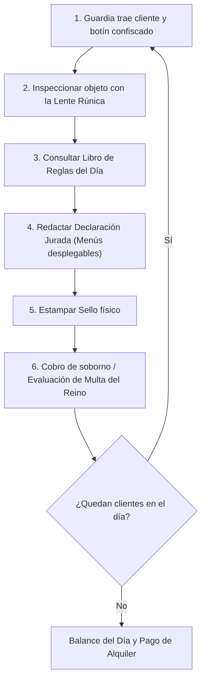

# ⚙️ Mecánicas Core - Notaría de Aventureros

> [!NOTE] **Definición del Núcleo**
> *Notaría de Aventureros* aborda la temática **"Al otro lado de la Ley"** desde adentro del propio sistema: evasión fiscal y contrabando mediante vacíos legales burocráticos, sin violencia y con humor satírico.

---

## 🎯 High Concept

- **Premisa:** Eres un burócrata de aduanas en un reino de fantasía opresivo donde el rey cobra impuestos desorbitados y prohíbe artefactos cotidianos. Tu trabajo oficial es procesar el papeleo, pero tu verdadera misión es ayudar a los aventureros a evadir la ley reclasificando sus peligrosos botines mediante trampas y tecnicismos burocráticos.
- **Gancho:** Simulador de lógica y gestión estilo *Papers, Please*, donde la estricta literalidad de leyes absurdas es tu mejor herramienta para romper la ley legalmente.
- **Justificación de la Temática:** Cumple las normativas de la Jam: sin apología a delitos de la vida real ni violencia explícita. El jugador opera en el límite moral y legal del reino a través de la comedia.

---

## 🔄 Bucle Principal (Core Loop)

1. **Entrada / Presentación:** El guardia gato deposita la bolsa de despacho y presenta los antecedentes del aventurero.
2. **Investigación:** Utilizas la **Lente Rúnica** arrastrándola sobre el objeto para desvelar propiedades ocultas (ej. *inflamable*, *encantado*, *maldito*).
3. **Consulta de Normativas:** Revisas las directivas absurdas del día en el **Libro de Reglas**.
4. **Redacción de Coartada:** En la **Declaración Jurada**, seleccionas opciones en listas desplegables para redefinir el objeto (ej. declarar una espada en llamas como *"herramienta térmica para repostería"*).
5. **Veredicto y Sellado:** Arrastras el sello correspondiente y lo estampas con impacto de tinta.
6. **Resolución:** Cobras tu comisión/soborno si engañaste al sistema, o recibes una multa del Inspector Real si cometiste un error lógico insostenible.

---

## 🎮 Controles e Interacción (Point & Click / Drag & Drop)

| Acción | Control | Función |
| :--- | :--- | :--- |
| **Arrastrar Herramientas** | `Click Izquierdo + Arrastre` | Desplazar la Lente Rúnica sobre los objetos o los Sellos hacia el documento. |
| **Completar Declaración** | `Click Izquierdo` en `OptionButton` | Elegir las cláusulas legales y descripciones alternativas del ítem. |
| **Consultar Manual** | `Click` o Tecla `Espacio` | Abrir / cerrar el Libro de Reglas a pantalla completa. |
| **Pausa / Opciones** | `Escape` o Click en `Botón Menú` | Pausar la jornada y acceder a ajustes de sonido. |

---

## ⚖️ Condiciones de Victoria y Derrota

- **Victoria:** Sobrevivir los 4 días laborales de la semana manteniendo un balance de oro positivo tras pagar los costos obligatorios (alquiler, comida, calefacción).
- **Derrota (Game Over):** Quebrar financieramente porque tus multas del Inspector Real superen tus ahorros y comisiones, terminando encarcelado en las mazmorras reales.

---

## 📈 Progresión y Curva de Dificultad

- **Día 1 (Inducción):** Solo sellado directo con reglas sencillas y evidentes (Aprobado / Denegado según peso o material).
- **Día 2 (Inspección Oculta):** Se desbloquea la **Lente Rúnica** para detectar propiedades invisibles (magia, veneno).
- **Día 3 (Ingeniería Burocrática):** Se activa la **Declaración Jurada**. Hay que armar coartadas combinando categorías de objetos con usos no bélicos.
- **Día 4 (Auditoría del Reino):** Reglas trampa y contradictorias, múltiples sellos y aventureros desesperados con botines muy cuestionables.
