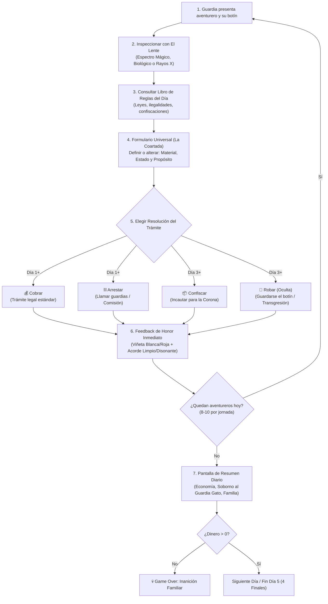
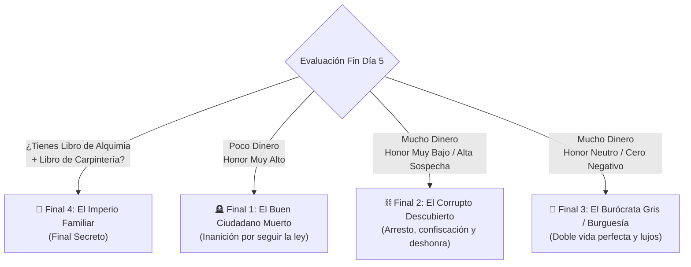

# ⚙️ Mecánicas Core - Notaría de Aventureros

> [!NOTE] **Definición del Núcleo de Juego**
> *Notaría de Aventureros* (o *El Vacío Legal*) aborda la temática **"Al otro lado de la Ley"** poniendo al jugador en los zapatos de un oficial de aduanas que opera al margen de la ley desde dentro del propio aparato estatal, equilibrando deber, supervivencia familiar, codicia y corrupción.

---

## 🎯 Ficha Técnica y High Concept

- **Título Provisional:** *Notaría de Aventureros* (o *El Vacío Legal*)
- **Género:** Puzzle Lógico / Simulador de Gestión Burocrática (Estilo *Papers, Please*)
- **Temática Game Jam:** "Al otro lado de la ley"
- **Premisa:** Eres un oficial de aduanas en un reino de fantasía opresivo. Evalúas el botín de los aventureros para cobrar impuestos, arrestarlos o confiscar sus bienes. Sin embargo, puedes usar tu posición para robar objetos y enriquecerte, operando al margen de la ley desde dentro del propio sistema.
- **Motor:** Godot Engine (2D, Pixel Art).
- **Estética:** Pixel Art (Vista isométrica/frontal del escritorio). Fantasía lúgubre medieval, oficina arcaica y desgastada por la tinta y la burocracia.

---

## 🔄 Bucle Principal (Core Loop)

---

## 🪑 El Escritorio de Trabajo (Mecánicas de Inspección)

El jugador interactúa con una mesa llena de herramientas físicas para analizar los objetos antes de tomar una decisión:

### 1. 🔍 El Lente (La Verdad)
- **Función:** Se arrastra físicamente sobre el objeto en la mesa.
- **Sin texto explicativo:** No proporciona etiquetas ni texto plano; revela **visualmente** propiedades ocultas del objeto según el filtro activo.
- **3 Filtros / Espectros Conmutables:**
  - 🔮 **Espectro Mágico:** Revela runas de encantamiento, auras elementales (fuego, hielo, relámpago) y energía arcana latente.
  - 🧬 **Espectro Biológico:** Revela residuos orgánicos, toxinas, venenos activos, esporas fúngicas, sangre o parásitos vivos.
  - 💀 **Espectro de Rayos X:** Revela la estructura interna, compartimentos secretos, densidad ósea, mecanismos ocultos o núcleos metálicos escondidos dentro de materiales inocuos.

### 2. 📝 El Formulario Universal (La Coartada)
- **Naturaleza:** Un documento oficial permanente fijado en la mesa de trabajo.
- **Estructura (3 Menús Desplegables):**
  1. **Material:** (ej. *Hierro dulce, Madera común, Plata sagrada, Hueso maldito, Cristal arcano...*)
  2. **Estado:** (ej. *Inerte, Consagrado, Infectado, Flamígero, Inestable, Roto...*)
  3. **Propósito:** (ej. *Ornamento doméstico, Utensilio agrícola, Estudio pedagógico, Arma de guerra, Culto prohibido...*)
- **Mecánica del Vacío Legal:** Se usa para definir legalmente el objeto ante los ojos de la Corona. 
  - El jugador puede **decir la verdad** para acatar las leyes al pie de la letra.
  - O puede **mentir estratégicamente**, reclasificando el ítem (ej. clasificar un báculo nigromántico como "Madera / Inerte / Herramienta ortopédica de soporte") para crear un vacío legal, burlar las prohibiciones del día y evitar el arresto del cliente.

### 3. 📖 El Libro de Reglas
- **Actualización Diaria:** Cada mañana, un heraldo real añade nuevas directivas, decretos reales y excepciones.
- **Función Jurídica:** Dicta estrictamente qué es ilegal, qué debe confiscarse y qué infracciones conllevan el arresto inmediato del portador.
- **Principio Fundamental:** *Todo lo que no esté prohibido explícitamente, paga impuestos normales.* El jugador debe contrastar las propiedades reales reveladas por El Lente con lo asentado en el Formulario Universal y las normas del libro.

---

## ⚡ Resoluciones del Trámite (Acciones del Jugador)

En lugar de depender únicamente de sellos convencionales, el destino de cada cliente y su botín se resuelve mediante **acciones directas**, las cuales se habilitan progresivamente a lo largo de los días:

| Acción | Disponibilidad | Descripción y Consecuencias en Gameplay | Impacto en Honor | Impacto Económico |
| :--- | :---: | :--- | :--- | :--- |
| **💰 Cobrar** | **Día 1+** | Tramitas el objeto por la vía legal ordinaria. El aventurero paga su tasa arancelaria y se marcha en paz. | Sube Honor si la legalidad era correcta; baja si dejaste pasar contrabando evidente. | Garantiza tu sueldo base al final del día. |
| **⛓️ Arrestar** | **Día 1+** | Haces una señal a los guardias para apresar al aventurero. | Sube Honor si el arresto estaba justificado por el Libro de Reglas; **baja severamente si arrestas a un inocente**. | Genera una **Comisión por Captura** extra en el resumen. |
| **📦 Confiscar** | **Día 3+** | Incautas el objeto en nombre del Reino. El cliente es despojado de su botín pero no necesariamente encarcelado. | Sube o baja dependiendo de si el Libro de Reglas realmente exigía la incautación de esa categoría de bien. | Concede un **Bono de Incautación** estatal al final de la jornada. |
| **🤫 Robar** | **Día 3+** | Te guardas el objeto bajo el escritorio para tu beneficio personal. **Mecánica oculta:** El libro de reglas nunca explica esta acción; el jugador descubre por sí mismo la transgresión. | **Baja el honor** siempre (alimenta la sospecha del reino). | Puedes venderlo al final del día o conservarlo. **No hay etiquetas de precio:** debes intuir su valor. El guardia gato te vigila (aumenta su soborno). |

---

## 🎭 Sistemas Ocultos y Meta-Juego

### 1. ⚖️ Sistema de Honor (Inspiración *Red Dead Redemption 2*)
- **Escala Numérica Interna:** Variable flotante/entera oculta que va de **-100 a +100**.
  - `+100`: Ciudadano ejemplar, burócrata leal y devoto de la Corona.
  - `0`: Burócrata gris, perfil bajo, equilibrio moral perfecto (sospecha nula).
  - `-100`: Corrupción descarada, alta sospecha, criminal infiltrado en el Estado.
- **Retroalimentación Inmediata (Sin Barra en Pantalla):**
  - El jugador **nunca ve un número ni una barra de interfaz** para preservar la inmersión diegética.
  - **Honor Positivo (Acción Justa/Legal):** Destello sutil de **viñeta blanca** en los bordes de la pantalla + un **acorde musical limpio y consonante** (guitarra afinada / campana brillante).
  - **Honor Negativo (Robo/Injusticia/Arresto Injusto):** Destello sutil de **viñeta roja/oscura** + un **tono disonante, grave o raspado** de cuerda destensada.

### 2. 🪙 Economía Doméstica y Fin del Día (Pantalla de Resumen)
Al caer la noche, se presenta el balance contable obligatorio:
- **Ingresos del Día:**
  - Sueldo base por jornada.
  - Comisiones por arrestos justificados.
  - Bonos de incautación legal.
  - Ganancias por venta en el mercado negro de objetos robados (si decides venderlos).
- **Gastos Obligatorios:**
  - Comida y manutención familiar.
  - Alquiler y gastos imprevistos de la casa.
  - **🐱 El Soborno al Guardia Gato:** El guardia con armadura está siempre presente en tu mesa. Si usaste la acción *"Robar"* durante el día, él se dio cuenta; la cuota de *"Soborno al Guardia"* **aumenta drásticamente** en el resumen nocturno para comprar su silencio.
- **💀 Condición de Game Over Inmediato:**
  - Si en cualquier resumen diario tu dinero llega a **cero o valor negativo**, se produce la derrota inmediata por **inanición y miseria de tu familia**.

---

## 🎮 Controles e Interacción (Point & Click / Drag & Drop)

| Acción | Control | Función en Juego |
| :--- | :--- | :--- |
| **Arrastrar El Lente** | `Click Izquierdo + Arrastre` | Desplazar la lupa sobre el botín en la mesa de inspección. |
| **Cambiar Filtro de Lente** | `Rueda del Ratón` / Teclas `1, 2, 3` / Clic en perilla | Conmutar entre Espectro Mágico (1), Biológico (2) y Rayos X (3). |
| **Configurar Coartada** | `Click Izquierdo` en `OptionButton` | Modificar Material, Estado y Propósito en el Formulario Universal. |
| **Consultar Libro de Reglas** | `Click` en el libro o Tecla `Espacio` | Abrir / cerrar el compendio de normativas y leyes del día. |
| **Ejecutar Resolución** | `Click Izquierdo` en botones de acción | Presionar `Cobrar`, `Arrestar`, `Confiscar` o `Robar`. |
| **Pausa / Ajustes** | `Tecla Escape` | Menú de pausa, reanudación y controles de volumen. |

---

## 🏆 Condiciones de Victoria: Los 4 Finales

El clímax del Día 5 evalúa tres parámetros fundamentales: **Dinero acumulado**, **Nivel de Honor (Sospecha)** y la **Retención de Objetos Especiales**:

1. **Final 1 (El Buen Ciudadano Muerto):** Honor muy alto, pero fondos económicos insuficientes. Cumpliste todas las órdenes de la Corona, pero tu sueldo de miseria condena a tu familia a morir de hambre.
2. **Final 2 (El Corrupto Descubierto):** Honor en mínimos (-100 a -70, alta sospecha) con mucho dinero acumulado. El reino te descubre, la guardia te arresta frente a tus seres queridos y te despojan de todo.
3. **Final 3 (El Burócrata Gris / Burguesía):** Honor equilibrado y neutro (rondando el cero negativo, sospecha disipada) con suficiente dinero. Dominaste la burocracia, viviste una doble vida impecable y tu familia asciende a la burguesía.
4. **Final 4 (El Imperio Familiar / Final Secreto):** Requiere haber robado y conservado los dos botines clave (**Libro de Alquimia** en Día 3 y **Libro de Carpintería** en Día 4) siguiendo las pistas de los resúmenes diarios. La hija transmuta en oro la madera comprada por el hijo: la familia se vuelve obscenamente rica y compra el propio reino.
