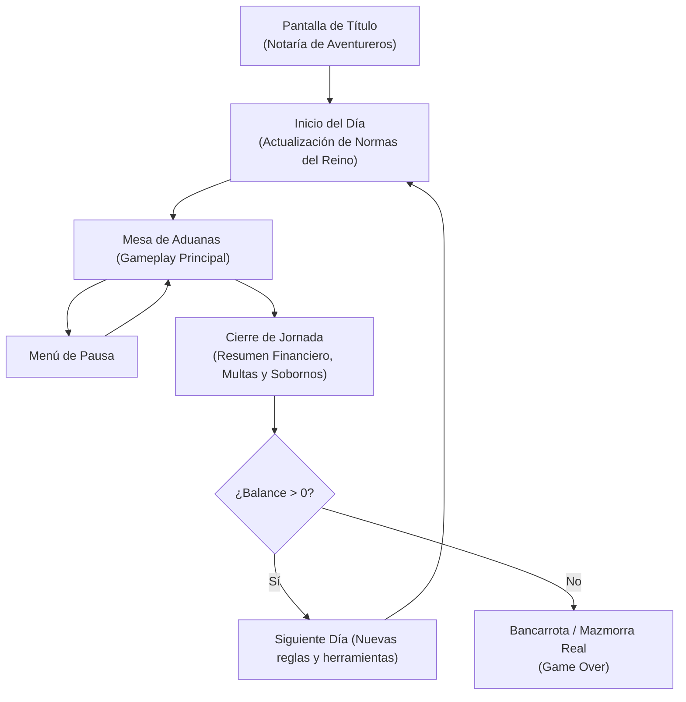

# 🖥️ Diseño de Interfaz (UI / UX) - Mesa de Aduanas

> [!NOTE] **Enfoque de UI**
> Al ser un simulador estilo *Papers, Please*, la interfaz **ES** el juego. La mesa de la aduana y sus documentos constituyen la pantalla principal de interacción física (drag & drop y point & click).

---

## 🖼️ Prototipo de la Mesa de Juego

---

## 🧭 Distribución de la Escena (`Desk_View.tscn`)

| Elemento                      | Posición en Pantalla    | Tipo de Nodo                | Función / Interacción                                                                         |
| :---------------------------- | :---------------------- | :-------------------------- | :-------------------------------------------------------------------------------------------- |
| **Botón Menú**                | Superior Izquierda      | `TextureButton`             | Abre pausa, configuración y opciones para reiniciar el día.                                   |
| **Ventanilla / Exterior**     | Centro Fondo            | `TextureRect` / `TileMap`   | Vista hacia el arco del castillo con la fila de aventureros en espera.                        |
| **Personaje en Ventanilla**   | Centro Media            | `AnimatedSprite2D`          | Cliente (burócrata catgirl estresada) / NPC aventurero actual.                                |
| **Guardia Gato**              | Derecha Media           | `AnimatedSprite2D`          | Guardia con armadura. Muestra reacciones y diálogos (murmullos graves).                       |
| **Pergamino de Antecedentes** | Derecha Fondo (Muro)    | `Control` / `RichTextLabel` | Ficha técnica y antecedentes del aventurero en turno.                                         |
| **Bolsa de Despacho**         | Izquierda de la Mesa    | `Area2D` / `Button`         | El jugador deposita aquí los objetos ya categorizados                                         |
| **Casco**                     | Centro-Izquierda Mesa   | `Area2D` (Slot)             | Objeto a clasificar, en este caso un casco                                                    |
| **Declaración Jurada**        | Inferior Izquierda Mesa | `Control` (Scroll UI)       | Documento interactivo con menús desplegables (`OptionButton`) para armar la coartada.         |
| **Lente Rúnica**              | Centro Inferior Mesa    | `Area2D` (Draggable)        | Herramienta de inspección que se arrastra sobre los objetos para revelar propiedades mágicas. |
| **Sellos de Aduana**          | Inferior Derecha Mesa   | `Control` / `Area2D`        | Sellos de madera (aprobado / rechazado / exento) que se arrastran para estampar el veredicto. |

---

## 🔀 Flujo de Pantallas

---

## 🖱️ Comportamiento de Componentes Interactivos

- **Arrastre de Documentos y Herramientas (Lente / Sellos):**
  - Al hacer click: escala ligera `1.05x`, elevación en `z_index` para superponerse.
  - Al soltar sobre un objeto/documento: reproduce sonido de impacto seco de madera y activa la lógica de comprobación.
- **Declaración Jurada (Menús desplegables):**
  - Nodos `OptionButton` integrados dentro de la textura de pergamino.
  - Al seleccionar combinaciones de coartada (ej. *"Espada flamígera"* $\rightarrow$ *"Herramienta térmica de cocina"*), se actualiza el estado de validación.
- **Libro de Reglas (Overlay emergente):**
  - Desplegable a pantalla completa con pestañas laterales categorizadas (Armas, Pociones, Monstruos, Impuestos).
  - Al abrirse, activa el filtro de audio *Low-Pass* en la música ambiental.
