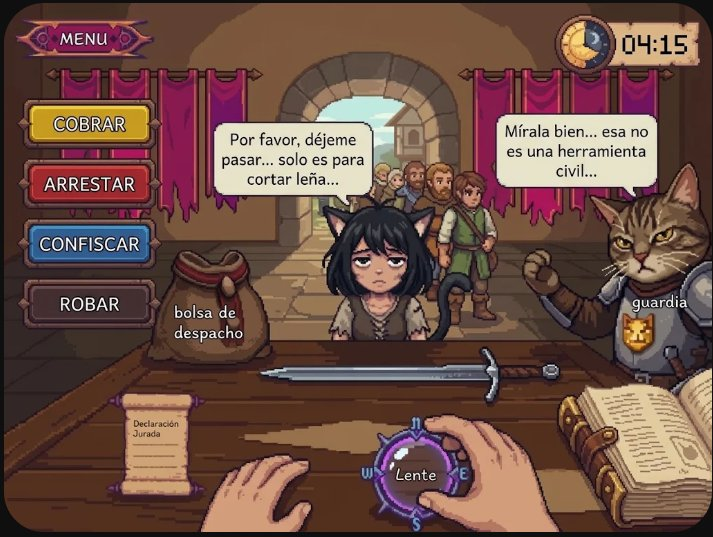
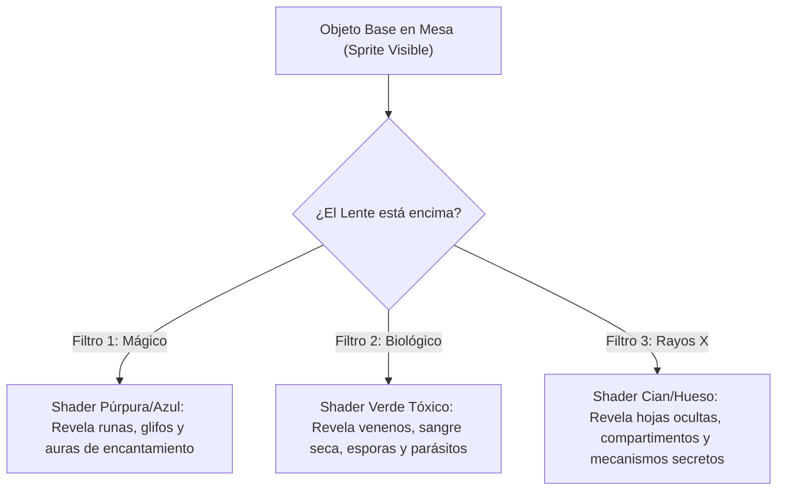
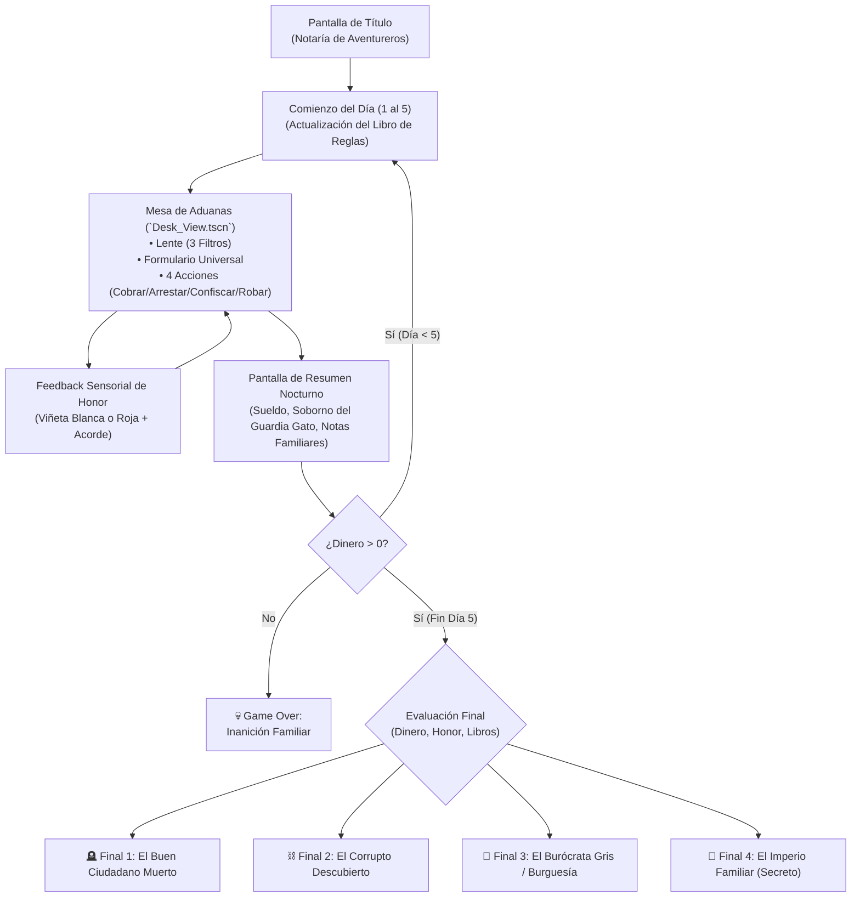

# 🖥️ Diseño de Interfaz (UI / UX) - Mesa de Aduanas

> [!NOTE] **Enfoque de UI & Diegesis**
> Al ser un simulador estilo *Papers, Please*, la interfaz **ES** el juego. La mesa de aduanas, los pergaminos, los instrumentos de análisis y los botones de trámite componen un entorno físico reactivo. Para maximizar la inmersión, el jugador **no tiene barras de estadísticas tradicionales en pantalla**; todo se comunica mediante el entorno y feedback sensorial.

---

## 🖼️ Prototipo de la Mesa de Trabajo



---

## 🧭 Distribución de la Escena (`Desk_View.tscn`)

```text
+-----------------------------------------------------------------------------------+
| [MENÚ]                                                    [Reloj Sol/Luna: 04:15] |
|                                                                                   |
| [ COBRAR   ]         [Bocadillo Cliente]           [Bocadillo Guardia]            |
| [ ARRESTAR ]         "Por favor déjeme pasar..."   "Mírala bien..."               |
| [ CONFISCAR]                  [Aventurera en Ventanilla]    [Guardia Gato]        |
| [ ROBAR    ]                  (Fila de fondo en arco)       (Armadura & Escudo)   |
|                                                                                   |
| -------------------------- MESA DE TRABAJO -------------------------------------- |
|                                                                                   |
|  [Bolsa de Despacho]          [Espada / Botín a Inspeccionar]                     |
|                                                                                   |
|  [Declaración Jurada /]       [Manos del Jugador]           [Libro de Reglas      |
|   Formulario Universal]       [Lente con Dial N/S/E/W]       Abierto con Ilustr.] |
+-----------------------------------------------------------------------------------+
| >>> [Bordes de Pantalla: Viñeta Blanca / Roja para Feedback de Honor Oculto] <<<  |
+-----------------------------------------------------------------------------------+
```

| Elemento | Posición en Pantalla | Tipo de Nodo | Función / Comportamiento UX |
| :--- | :--- | :--- | :--- |
| **Botón Menú** | Superior Izquierda | `TextureButton` | Pausa, reanudación, reinicio de jornada y ajustes de audio. |
| **Reloj de Jornada** | Superior Derecha | `Control` / `Label` | Cuadrante con ciclo visual Sol/Luna y minutero digital (ritmo del turno). |
| **Botones de Resolución** | Lateral Izquierdo Superior | `VBoxContainer` | Acciones directas apiladas: `Cobrar` (amarillo), `Arrestar` (rojo), `Confiscar` (azul) y `Robar` (pardo). |
| **Ventanilla / Exterior** | Fondo Centro | `TextureRect` | Arco de piedra medieval con vista a la fila de aventureros en espera y estandartes reales. |
| **Aventurero (Cliente)** | Centro Ventanilla | `AnimatedSprite2D` | Cliente actual con bocadillo de diálogo dinámico (suplica, excusa o nerviosismo). |
| **Guardia Gato** | Derecha Ventanilla | `AnimatedSprite2D` | Centinela con armadura y escudo dorado; emite comentarios de sospecha y guiños cómplices. |
| **Bolsa de Despacho** | Centro-Izquierda Mesa | `Area2D` / `Sprite2D` | Bolsa de cuero donde se deposita o retira el botín. |
| **Bandeja / Zona Central** | Centro de la Mesa | `Marker2D` / `Area2D` | Espacio físico donde descansa el objeto a inspeccionar (ej. espada, reliquias). |
| **El Lente (La Verdad)** | Centro Inferior Mesa | `Area2D` (Draggable) | Lupa con dial direccional (N/S/E/W) sostenida por las manos en primera persona. |
| **Formulario Universal** | Inferior Izquierda Mesa | `Control` (Scroll/Card) | Pergamino con menús desplegables para asentar la coartada oficial. |
| **Libro de Reglas** | Inferior Derecha Mesa | `TextureButton` / `Control`| Tomo abierto de páginas gruesas con las normativas e ilustraciones del día. |
| **Viñeta de Honor** | Pantalla completa (CanvasLayer)| `ColorRect` con Shader | Flash sutil de viñeta blanca (honor positivo) o roja (honor negativo). |

---

## 🔍 Mecánica Visual de El Lente (3 Filtros)

El Lente utiliza un shader de máscara circular que revela texturas y capas ocultas sobre el sprite del objeto:



---

## 📝 Formulario Universal (La Coartada)

- **3 Menús Desplegables (`OptionButton`):**
  1. `Material`: Hierro, Madera, Oro, Hueso, Cuero, Cristal arcano, etc.
  2. `Estado`: Inerte, Flamígero, Tóxico, Encantado, Roto, etc.
  3. `Propósito`: Agrícola, Médico, Doméstico, Bélico, Estudio Pedagógico, etc.
- **Interacción:** El jugador puede reflejar con fidelidad lo que revela El Lente o mentir alterando los campos para evadir las prohibiciones del Libro de Reglas del día.

---

## ⚡ Botones de Resolución de Trámite

Aparecen alineados a la derecha de la mesa:
1. **`💰 Cobrar` (Disponible Día 1 a 5):** Estampa un recibo fiscal, entrega el botín al cliente y suma tu sueldo base.
2. **`⛓️ Arrestar` (Disponible Día 1 a 5):** Hace sonar una campana de alarma; guardias apresan al aventurero. Otorga comisión si el libro lo exigía.
3. **`📦 Confiscar` (Disponible Día 3 a 5):** El objeto se traslada a la caja fuerte del Reino. Da bono de incautación si la ley lo ordenaba.
4. **`🤫 Robar` (Disponible Día 3 a 5 - Mecánica Oculta):**
   - Un botón o cajón falso bajo el escritorio, sin explicación en el Libro de Reglas.
   - El objeto cae en tu inventario personal oculto.
   - La pantalla emite una **viñeta roja** con tono disonante (baja de honor).
   - El Guardia Gato guiña un ojo o sonríe de perfil (se entera del robo).

---

## 🌙 Pantalla de Fin de Jornada (`DaySummary_View.tscn`)

Al terminar de procesar los 8-10 clientes del día:

```text
+-------------------------------------------------------------------+
|                    BALANCE CONTABLE - DÍA [X]                     |
+-------------------------------------------------------------------+
|  INGRESOS:                                                        |
|    • Sueldo Base de la Jornada ...................... +50 Oro     |
|    • Comisiones por Captura ......................... +30 Oro     |
|    • Bonos de Incautación Real ...................... +15 Oro     |
|    • Venta de Botines Robados ....................... [+ Vender?] |
|        [Ítem Robado A] -> [Vender por ?? Oro] / [Conservar en Baúl]
|                                                                   |
|  GASTOS OBLIGATORIOS:                                             |
|    • Manutención & Alimentos Familiares ............. -35 Oro     |
|    • Alquiler de Buhardilla ......................... -20 Oro     |
|    • SOBORNO AL GUARDIA GATO ........................ -60 Oro 🐱  |
|      (¡Aumenta drásticamente si robaste durante el turno!)        |
|                                                                   |
|  ---------------------------------------------------------------  |
|  BALANCE FINAL DEL DÍA: [ XXX Oro ]                               |
|                                                                   |
|  DIARIO FAMILIAR / CARTAS:                                        |
|  "Día 3: Tu hija se pasa las noches leyendo sobre transmutación..."|
|  "Día 4: Tu hijo compró un cargamento masivo de madera..."        |
|                                                                   |
|                 [ CONTINUAR AL SIGUIENTE DÍA ]                    |
+-------------------------------------------------------------------+
```

---

## 🔀 Flujo Global de Pantallas


