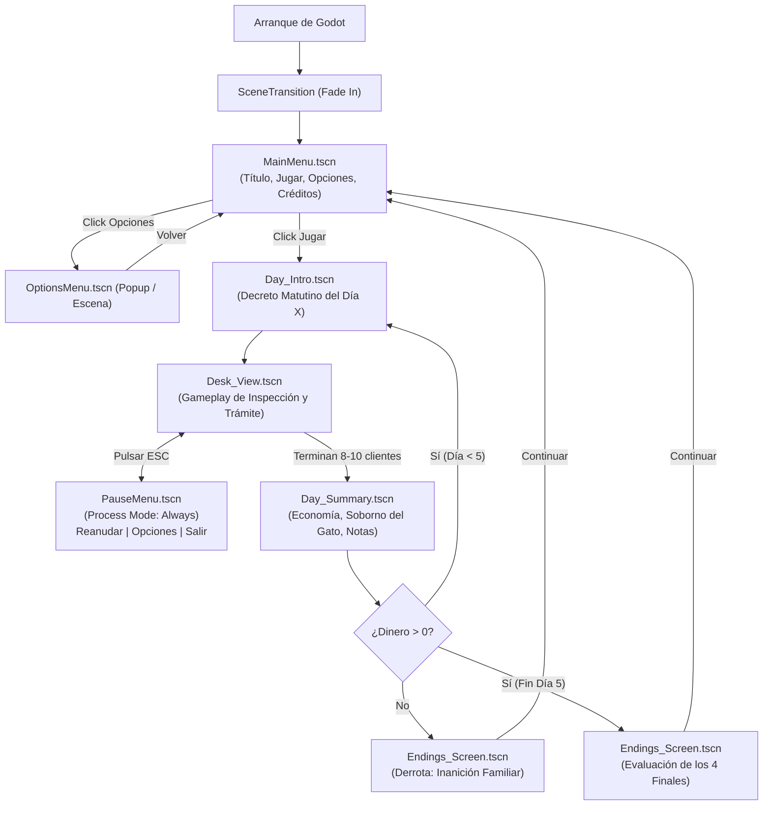

# 💻 Convenciones y Arquitectura Godot - Notaría de Aventureros

> [!NOTE]
> Dado que todos en el equipo tenemos perfil de desarrollo, la clave para maximizar la velocidad y evitar conflictos de Git es desacoplar el proyecto en escenas independientes mediante el patrón **Señales hacia arriba, llamadas hacia abajo** (*Signals up, calls down*), un gestor de persistencia global (`GameManager.gd`) y un sistema centralizado de transiciones y audio.

---

## 🛠️ Entorno y Configuración del Motor

- **Motor:** Godot Engine 4.x (2D)
- **Lenguaje:** GDScript
- **Resolución Base:** `1280x720` (o resolución nativa pixel art `640x360` escalada con `viewport` / `canvas_items`).
- **Modo de Texturas:** Filtro `Nearest` en configuración de proyecto para un pixel art perfectamente nítido.
- **Export Objetivo:** Ejecutable de escritorio Windows `.exe`.

---

## 🏗️ Árbol de Escenas y Arquitectura Integral del Proyecto

Esta estructura cubre el ciclo completo del videojuego: **arranque, menú principal, ajustes persistentes, pausa, flujo entre días, bucle de gameplay de aduana, resúmenes nocturnos y los 4 finales**:

```text
res://
├── Scenes/
│   ├── Core/
│   │   ├── GameManager.tscn         # Autoload: Persistencia, Día (1-5), Dinero, Honor (-100 a 100), Baúl
│   │   ├── AudioManager.tscn        # Autoload: Buses Master/BGM/SFX, filtro Low-Pass y SFX de honor
│   │   └── SceneTransition.tscn    # Autoload (CanvasLayer): Fades a negro entre pantallas
│   │
│   ├── Menus/
│   │   ├── MainMenu.tscn            # Pantalla de título: Jugar, Opciones, Créditos, Salir
│   │   ├── OptionsMenu.tscn         # Ajustes: Volumen Master/BGM/SFX, Pantalla Completa (Reutilizable)
│   │   ├── PauseMenu.tscn           # Popup in-game (ESC): Reanudar, Opciones, Reiniciar Día, Salir al Menú
│   │   └── CreditsMenu.tscn         # Créditos del equipo y menciones reglamentarias de la jam
│   │
│   ├── Flow/
│   │   ├── Day_Intro.tscn           # Pantalla de inicio de jornada: "Día X: Decreto Real matutino"
│   │   ├── Day_Summary.tscn         # Resumen nocturno: Balances, soborno del gato, notas familiares
│   │   └── Endings_Screen.tscn      # Evaluación final: Epílogos para los 4 Finales y Game Over
│   │
│   └── Desk/
│       ├── Desk_View.tscn           # Escena raíz del gameplay diario (integra los sub-módulos)
│       ├── Counter_Window.tscn      # Marco exterior, aventurero actual y guardia gato
│       ├── Inspection_Area.tscn     # Bandeja física donde se aloja el botín actual
│       ├── Tool_Lens.tscn           # Lente arrastrable con dial de 3 filtros de shader
│       ├── Universal_Form.tscn      # Formulario fijo con los 3 OptionButtons (coartada)
│       ├── Rulebook_Popup.tscn      # Manual de leyes a pantalla completa
│       ├── Action_Panel.tscn        # Botones de trámite: Cobrar, Arrestar, Confiscar y Robar
│       └── Honor_Vignette.tscn      # CanvasLayer overlay: Destello blanco/rojo periférico
│
├── Scripts/
│   ├── Core/
│   │   ├── game_manager.gd          # Máquina de estados global, economía y honor
│   │   ├── audio_manager.gd         # Manejo dinámico de música, SFX y audio buses
│   │   └── scene_transition.gd      # Control de animación de fundidos y change_scene_to_file
│   ├── Menus/
│   │   ├── main_menu.gd             # Navegación del menú principal
│   │   ├── options_menu.gd          # Control de sliders de audio (AudioServer) y display
│   │   └── pause_menu.gd            # get_tree().paused y gestión de inputs de escape
│   ├── Flow/
│   │   ├── day_intro.gd             # Muestra decreto del día y avanza a Desk_View
│   │   ├── day_summary.gd           # Cálculo nocturno, lógica de sobornos y avance
│   │   └── endings_screen.gd        # Carga el texto e ilustración del final correspondiente
│   ├── Desk/
│   │   ├── desk_view.gd             # Orquestador del turno: coordina cliente, bandeja y acciones
│   │   ├── tool_lens.gd             # Lógica de arrastre y conmutación de shaders
│   │   ├── universal_form.gd        # Lectura y reseteo de los 3 desplegables
│   │   └── action_panel.gd          # Emisión de señales de resolución (Cobrar/Arrestar/Confiscar/Robar)
│   └── Data/
│       ├── ItemsDatabase.gd         # Diccionario de los 40-50 objetos y sus propiedades ocultas
│       └── DailyRulesDatabase.gd    # Leyes y prohibiciones específicas para cada día (1 a 5)
│
├── Shaders/
│   ├── lens_mask.gdshader           # Máscara circular para El Lente
│   ├── spectrum_magic.gdshader      # Revelación de runas arcanas
│   ├── spectrum_bio.gdshader        # Revelación de toxinas y esporas
│   ├── spectrum_xray.gdshader       # Revelación de hojas ocultas y mecanismos
│   └── honor_vignette.gdshader      # Viñeta periférica blanca/roja
│
└── Assets/
    ├── Art/                         # Sprites PNG, texturas de UI y fuentes pixel
    └── Audio/                       # Pistas BGM (.ogg) y efectos SFX (.wav)
```

---

## 🔄 Flujo Completo del Ciclo de Vida del Juego



---

## ⚙️ ¿Cómo Resuelve Esta Estructura Cada Requisito del Juego?

### 1. 🎛️ Menú de Opciones Reutilizable (`OptionsMenu.tscn`)
- Se diseña como una escena de control (`Control`) independiente.
- **Doble propósito:** 
  - Se puede instanciar directamente dentro de `MainMenu.tscn`.
  - Se puede instanciar como ventana emergente (*popup*) dentro de `PauseMenu.tscn`.
- Modifica los buses de audio en tiempo real mediante `AudioServer`:
  ```gdscript
  func _on_master_slider_value_changed(val: float) -> void:
      AudioServer.set_bus_volume_db(AudioServer.get_bus_index("Master"), linear_to_db(val))
  ```

### 2. ⏸️ Menú de Pausa Seguro (`PauseMenu.tscn`)
- Se coloca dentro de un `CanvasLayer` con `layer = 100` para estar por encima de todos los elementos del escritorio.
- Su propiedad `process_mode` se configura en **`Node.PROCESS_MODE_ALWAYS`** (o `PROCESS_MODE_WHEN_PAUSED`).
- Al presionar `ui_cancel` (Tecla Escape), activa `get_tree().paused = true`, congelando la lógica del juego mientras el menú de pausa sigue respondiendo a clics del ratón.
- Al reanudar o reiniciar, restaura `get_tree().paused = false`.

### 3. 🎬 Transiciones Limpias (`SceneTransition.tscn` como Autoload)
- Evita cambios bruscos de pantalla. Cuenta con un `ColorRect` negro y un `AnimationPlayer` con animaciones de `fade_out` y `fade_in`.
- Método de cambio seguro:
  ```gdscript
  func change_scene(target_path: String) -> void:
      anim_player.play("fade_to_black")
      await anim_player.animation_finished
      get_tree().change_scene_to_file(target_path)
      anim_player.play("fade_from_black")
  ```

### 4. 💾 Estado Centralizado (`GameManager.gd` como Autoload)
- Al cambiar de escena (por ejemplo, de `Day_Intro` a `Desk_View`, o a `Day_Summary`), los nodos locales se destruyen, pero `GameManager` permanece en memoria.
- Mantiene vivas las variables críticas:
  - `current_day`: int (1 a 5)
  - `money`: int (arranca en 100)
  - `honor`: float (-100.0 a +100.0)
  - `stolen_inventory`: Array de objetos que te quedaste
  - `steals_today_count`: Cuántas veces presionaste `Robar` hoy (para inflar el soborno del gato)
  - `special_books_held`: Booleano para saber si tienes el *Libro de Alquimia* y el *Libro de Carpintería*

---

## 👥 Reparto de Tareas Técnicas (Módulos de Desarrollo)

| Desarrollador | Módulos Clave | Responsabilidades Específicas |
| :--- | :--- | :--- |
| **Daniel** | **El Lente & Shaders de Inspección** (`Tool_Lens.tscn`, `Shaders/`) | - Programar el sistema de arrastre (`Area2D` / `_input`).<br>- Crear e integrar los shaders para los 3 espectros (Mágico, Biológico y Rayos X) revelando las capas ocultas del objeto sin texto. |
| **Esther** | **Formulario Universal & Validación Burocrática** (`Universal_Form.tscn`, `DailyRulesDatabase.gd`) | - Implementar los 3 menús `OptionButton` (Material, Estado, Propósito).<br>- Algoritmo de comparación lógica: Formulario vs. Libro de Reglas del Día para dictaminar legalidad, contrabando o justificación de arresto/confiscación. |
| **Michael** | **Meta-Juego, Economía, Audio & Menús** (`GameManager.gd`, `Day_Summary.tscn`, `AudioManager.gd`, `Menus/`) | - Flujo global: `MainMenu`, `PauseMenu`, `OptionsMenu` y `SceneTransition`.<br>- Máquina de estados de los 5 Días y balance financiero (sueldo, bonos, venta de robos y soborno creciente al Guardia Gato).<br>- Lógica del Sistema de Honor (-100 a +100) y disparo del feedback sonoro.<br>- Algoritmo de resolución de los 4 Finales en Día 5. |
| **Lucas** | **Integración Visual, Animaciones & UI** (`Counter_Window.tscn`, `Endings_Screen.tscn`) | - Conectar `AnimatedSprite2D` del Guardia Gato (reacción cómplice al presionar `Robar`).<br>- Montaje visual de los 40-50 objetos y sus sprites de capas reveladas.<br>- Integración estética de las pantallas de epílogo, decretos y menús. |

---

## 🏷️ Convenciones de Código GDScript

- **Archivos:** `snake_case.gd` para scripts (`game_manager.gd`), `PascalCase.tscn` para escenas (`DeskView.tscn`).
- **Nombres de Nodos:** `PascalCase` (`UniversalForm`, `InspectionArea`, `GuardCat`).
- **Tipado Estricto:** Siempre tipar variables y retornos: `var client_name: String = ""`, `func get_tax() -> int:`
- **Constantes:** `const MAX_CLIENTS_PER_DAY: int = 10`
- **Señales:** En pasado indicativo: `signal item_inspected(item_data)`, `signal resolution_selected(action_name)`.
