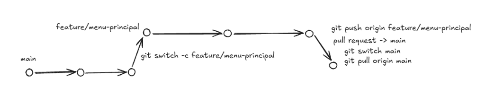
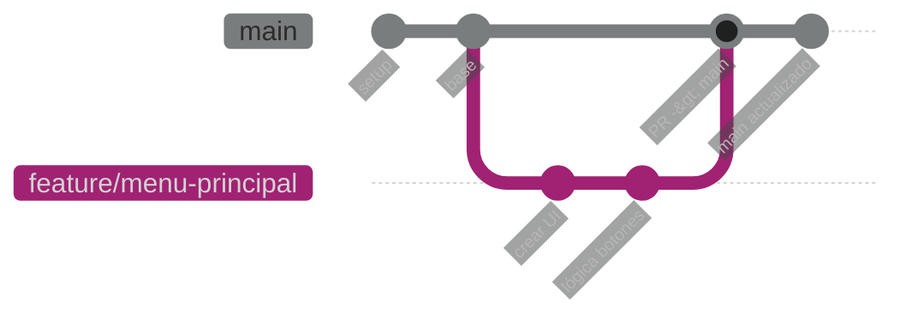

# 🌿 Flujo de Trabajo en Git

> [!TIP]
> Trabajar con ramas individuales evita que dos personas sobreescriban escenas, prefabs o código al mismo tiempo durante la Game Jam.

---

## 🗺️ Diagrama del Flujo





---

## 🚀 Paso a Paso

### 1. Actualizar tu rama `main` local
Antes de empezar una nueva tarea, asegúrate de tener la última versión del proyecto:
```bash
git switch main
git pull origin main
```

### 2. Crear y cambiarte a una nueva rama
Crea una rama descriptiva para tu función (ej. `feature/menu-principal`, `fix/colision-enemigo`):
```bash
git switch -c feature/menu-principal
```

### 3. Trabajar y guardar tus cambios (Commits)
Haz commits frecuentes y con mensajes claros:
```bash
git add .
git commit -m "feat: diseño inicial del menú principal"
```

### 4. Subir la rama al repositorio remoto
La primera vez que subas tu rama al servidor (GitHub / GitLab):
```bash
git push origin feature/menu-principal
```

### 5. Crear el Pull Request (PR)
1. Ve a la plataforma (GitHub / GitLab / etc.).
2. Abre un **Pull Request** apuntando de tu rama hacia `main`.
3. Notifica al equipo para revisión o merge rápido.

### 6. Volver a `main` y sincronizar
Una vez mergeado el PR, vuelve a `main` para tu siguiente tarea:
```bash
git switch main
git pull origin main
```

---

## 📌 Enlaces relacionados
- [[Convenciones|💻 Convenciones de Programación]]
- [[Bugs y Fixes|🐛 Bugs y Fixes]]
